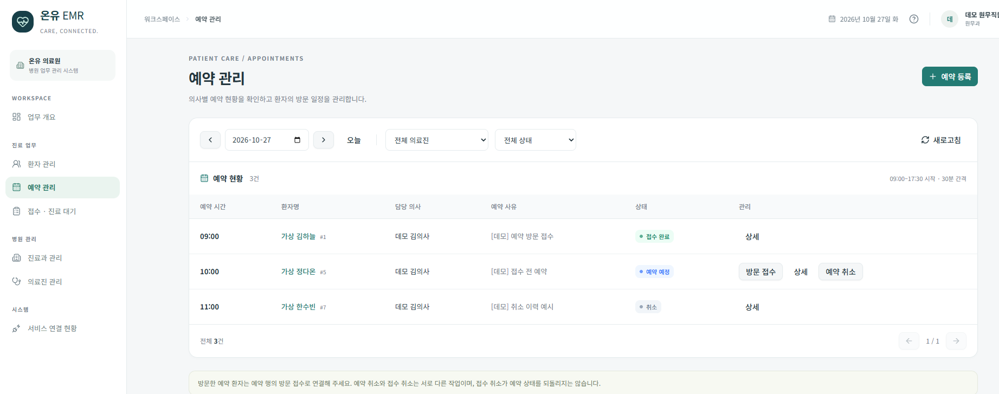
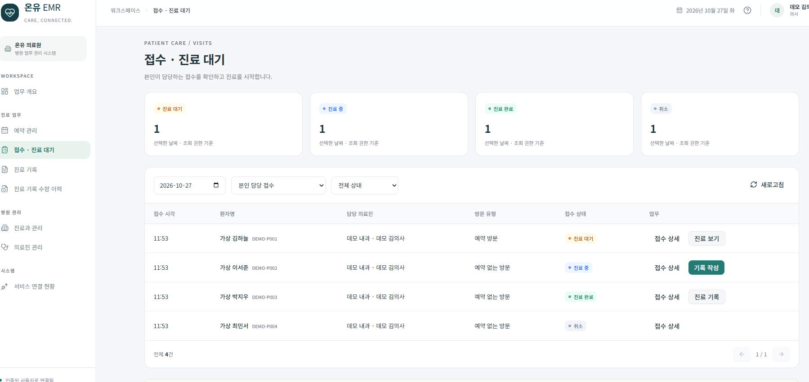
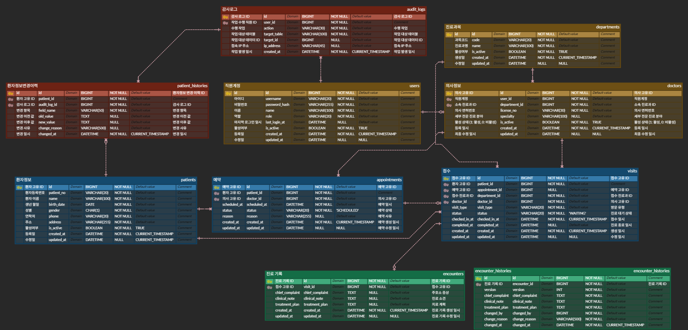

# 의료 EMR

**환자 등록부터 예약·방문 접수·진료 기록 작성까지, 병원 직원의 업무 흐름을 구현한 웹 애플리케이션입니다.**

백엔드 개발 포트폴리오로, 예약 중복 방지와 상태 전이, 진료 기록 원본 보존, 업무 트랜잭션과 감사 로그의 일관성에 집중했습니다. React 화면에서 실제 API를 호출해 역할별 업무를 수행할 수 있습니다. 시연 데이터는 가상 정보입니다.

---
## 기술 스택

| 구분 | 기술 |
| --- | --- |
| Backend |        |
| Database |  |
| Frontend |         |
| Test |     |
| Deployment — 준비 중 |    |
---

## 대표 화면

아래 화면은 가상 환자와 데모 계정을 사용한 시연입니다.

### 예약 관리 · STAFF

날짜·의사·상태별로 예약 현황을 조회하고 예약 등록, 방문 접수, 예약 취소를 처리합니다. 취소된 예약도 목록에 보존해 상태를 확인할 수 있습니다.



### 접수·진료 대기 · DOCTOR

담당 의사가 본인의 접수 목록과 대기·진료 중·완료·취소 상태를 확인합니다. 접수 상태에 따라 진료 보기, 기록 작성, 진료 기록 조회 버튼을 제공합니다.



---

## ERD

환자·예약·접수·진료 기록과 직원·의사·진료과, 감사 로그·수정 이력의 관계를 정리한 설계도입니다. 예약 슬롯과 업무 버전 등 일부 구현 상세는 이 이미지에 생략되어 있습니다.

[](docs/images/emr-erd.png)

이미지를 클릭하면 원본 크기로 확인할 수 있습니다.

---

## 5. 핵심 설계와 문제 해결

### 5.1 예약 동시성과 슬롯 단위 잠금

**문제**

예약 존재 여부를 확인한 뒤 저장하는 방식만으로는 동시에 들어온 요청의 중복 생성을 막을 수 없습니다. 예약이 없는 시간에는 잠글 예약 행도 없습니다. 의사 행을 잠그는 방식은 잠금 대상을 확보할 수 있지만, 같은 의사의 서로 다른 시간대 예약까지 대기하게 됩니다.

**적용한 방식**

의사·시간별 `appointment_slots` 행을 미리 생성하고, 해당 행에 비관적 락을 획득한 뒤 중복 검사와 예약 생성을 수행합니다.

```java
appointmentSlotRepository.findForUpdate(doctorId, scheduledAt)
        .orElseThrow(() -> new IllegalStateException("예약 슬롯이 존재하지 않습니다."));
```

```text
같은 의사 · 같은 시간 → 같은 슬롯 행을 잠그므로 순서대로 처리
같은 의사 · 다른 시간 → 서로 다른 슬롯 행을 잠가 처리
```

- 슬롯은 `(doctor_id, slot_at)` UNIQUE로 관리합니다.
- 슬롯 잠금 이후 SCHEDULED 예약의 존재 여부를 확인합니다.
- `appointments`의 `(doctor_id, scheduled_at)` UNIQUE가 중복 저장을 최종 차단합니다.
- 취소·접수 처리도 슬롯 → 예약 행 순서로 잠금을 획득합니다.
- 예약 시작 시간은 09:00~17:30, 30분 단위로 검증합니다.

현재 예약 UNIQUE는 상태와 관계없이 적용되므로 취소 후 같은 슬롯 재예약도 제한합니다. 활성 예약만 검사하는 업무 로직과 DB 제약조건을 일치시키는 것은 남은 개선 항목입니다. 잠금 범위 축소에 따른 성능 우열은 별도의 동일 조건 측정으로 판단해야 합니다.

관련 코드: [AppointmentService](src/main/java/com/example/emr/appointments/service/AppointmentService.java), [AppointmentSlotRepository](src/main/java/com/example/emr/appointments/repository/AppointmentSlotRepository.java)

### 5.2 AOP 감사 로그와 커밋 시점 처리

**문제**

업무 메서드마다 감사 저장 코드를 작성하면 중복이 발생합니다. 또한 서비스가 정상 반환해도 외부 트랜잭션이 나중에 롤백될 수 있어, 즉시 SUCCESS 로그를 남기면 실제 데이터와 불일치할 수 있습니다.

**적용한 방식**

`@Audit`로 작업과 대상을 선언하고, `@Around`에서 작업자·대상 ID·처리 결과를 공통 수집합니다.

```java
@Audit(action = "CREATE_APPOINTMENT", targetTable = "appointments", targetId = "#result")
```

```java
@Around(value = "@annotation(audit)", argNames = "joinPoint,audit")
public Object audit(ProceedingJoinPoint joinPoint, Audit audit) throws Throwable
```

`#result`는 생성 메서드의 반환 ID를, `#encounterId` 같은 표현식은 메서드 인자를 SpEL로 해석합니다. 정상 반환·실행 실패·권한 거부를 SUCCESS·FAILURE·DENIED로 구분하고, 원래 반환값과 예외를 호출자에게 전달합니다.

외부 트랜잭션에 참여 중이면 다음과 같이 실제 커밋 이후 성공 로그를 기록합니다.

```java
TransactionSynchronizationManager.registerSynchronization(new TransactionSynchronization() {
    @Override
    public void afterCommit() {
        write(userId, audit, targetId, AuditResult.SUCCESS, null);
    }
});
```

- `@Order(0)`으로 현재 메서드 권한 검사와 트랜잭션보다 바깥에서 실행합니다.
- 서비스 자체 트랜잭션이 이미 커밋된 경우 성공 로그를 바로 기록합니다.
- 일반 감사 저장은 REQUIRES_NEW로 처리해 업무 실패 로그를 보존합니다.
- 변경 이력과 직접 연결되는 감사 저장에는 업무 트랜잭션에 참여하는 별도 MANDATORY 경로를 사용합니다.

감사 저장 자체가 실패하면 서버 오류 로그를 남기고 업무 응답을 유지하므로, 업무 커밋과 감사 저장의 원자적 보장을 의미하지는 않습니다. 정상 반환 이후 발생한 외부 롤백도 자동으로 FAILURE로 기록하지는 않습니다.

관련 코드: [Audit](src/main/java/com/example/emr/audit_logs/annotation/Audit.java), [AuditAspect](src/main/java/com/example/emr/audit_logs/aspect/AuditAspect.java), [AuditLogService](src/main/java/com/example/emr/audit_logs/service/AuditLogService.java)

### 5.3 진료 기록 수정 전 원본·버전 보존

**문제**

기존 기록을 덮어쓰기만 하면 수정 전 내용을 확인할 수 없습니다. 누가 어떤 사유로 정정했는지도 추적할 수 있어야 합니다.

**적용한 방식**

수정 직전의 주호소·진료 소견·치료 계획 전체를 `encounter_histories`에 저장하고, 최신 Encounter의 내용을 수정하며 업무 버전을 증가시킵니다.

| 시점 | 최신 기록 | 보존된 이전 기록 |
| --- | --- | --- |
| 최초 생성 | 버전 1 | 없음 |
| 첫 번째 수정 | 버전 2 | 버전 1 전체 원본 |
| 두 번째 수정 | 버전 3 | 버전 1·2 전체 원본 |

- Visit → Encounter 순서로 비관적 락을 획득합니다.
- 이력 저장·원본 수정·버전 증가를 같은 트랜잭션에서 처리합니다.
- 수정자·필수 정정 사유·수정 시각을 함께 보존합니다.
- 요청의 null 필드는 유지하고, 실제 변경이 없으면 이력과 버전을 추가하지 않습니다.
- `(encounter_id, version)` UNIQUE로 동일 버전의 이력 중복 저장을 방지합니다.
- 업무 버전은 JPA `@Version`을 사용한 낙관적 락과 구분합니다.
- 이력 수정·삭제 API는 제공하지 않으며 상세 조회 시 요청한 Encounter 소속인지 확인합니다.

관련 코드: [EncounterService](src/main/java/com/example/emr/encounters/service/EncounterService.java), [EncounterHistory](src/main/java/com/example/emr/encounter_histories/domain/EncounterHistory.java)

### 5.4 접수·진료 상태 전이와 트랜잭션

**문제**

진료 시작과 접수 취소가 동시에 실행되거나, 진료 기록 저장과 완료 처리가 분리되면 상태와 데이터가 어긋날 수 있습니다.

**적용한 방식**

상태 변경 시 Visit 행을 잠그고 엔티티 메서드에서 허용된 전이만 수행합니다.

| 현재 상태 | 작업 | 변경 상태 | 수행 조건 |
| --- | --- | --- | --- |
| WAITING | 접수 취소 | CANCELLED | STAFF |
| WAITING | 진료 시작 | IN_PROGRESS | 담당 DOCTOR |
| IN_PROGRESS | 진료 기록 최초 생성 | COMPLETED | 담당 DOCTOR |

- 접수 등록은 환자 행을 먼저 잠근 뒤 같은 환자·진료과의 당일 활성 접수 중복을 확인합니다.
- 진료 시작과 취소는 동일 Visit 행을 잠그므로 최신 상태를 기준으로 전이 여부를 검사합니다.
- 진료 기록 최초 생성과 `visit.complete()`는 같은 트랜잭션으로 처리하고 완료 시각을 설정합니다.
- 진료 기록 생성이 실패하면 접수 완료 처리도 함께 롤백됩니다.
- COMPLETED·CANCELLED는 종료 상태이며, 별도 진료 완료 API는 제공하지 않습니다.
- 완료 후 담당 의사의 기록 정정은 허용하되 Visit은 COMPLETED를 유지합니다.
- 예약 환자의 접수를 취소해도 Appointment 상태를 자동으로 되돌리지 않습니다.

관련 코드: [Visit](src/main/java/com/example/emr/visits/domain/Visit.java), [VisitService](src/main/java/com/example/emr/visits/service/VisitService.java), [EncounterService](src/main/java/com/example/emr/encounters/service/EncounterService.java)

### 5.5 JWT 인증·역할 및 담당 의사 검증

**문제**

DOCTOR 역할만 확인하면 다른 의사의 진료를 시작하거나 기록을 수정할 수 있습니다. 화면에서 버튼을 숨기는 것만으로 API 접근을 통제할 수도 없습니다.

**적용한 방식**

JWT 인증과 역할별 메서드 인가에 더해, 상태 변경·기록 작성·정정에는 담당 의사 검증을 적용합니다.

```java
if (!visit.isAssignedDoctor(loginUser.userId())) {
    throw new AccessDeniedException("담당 의사가 아닙니다.");
}
```

- 로그인 시 BCrypt 비밀번호와 계정 활성 상태를 확인합니다.
- JWT 필터에서 토큰 서명·만료·종류를 검증하고 현재 DB 계정의 활성 상태와 역할을 확인합니다.
- `@PreAuthorize`로 역할을 검사하고, `LoginUser.userId()`와 Visit 담당 의사의 연결된 사용자 ID를 비교합니다.
- DOCTOR의 접수 조회는 서버에서 본인 담당으로 제한합니다.
- 진료 기록 조회는 담당 여부와 변경 권한을 구분합니다. 최신 기록·환자별 목록은 DOCTOR, 수정 이력은 DOCTOR·NURSE에게 허용합니다.
- access token은 프론트 메모리, refresh token은 HttpOnly·SameSite=Strict 쿠키에 보관합니다. HTTPS 배포 시 Secure 속성을 활성화합니다.

현재 로그아웃은 브라우저 refresh 쿠키를 제거하며, 이미 발급된 토큰의 서버 측 개별 폐기·재사용 감지는 후속 개선 항목입니다.

관련 코드: [JWT 필터](src/main/java/com/example/emr/global/filter/JwtAuthenticationFilter.java), [JwtProvider](src/main/java/com/example/emr/global/security/JwtProvider.java), [VisitService](src/main/java/com/example/emr/visits/service/VisitService.java)

---

## 6. 주요 API

### 인증·환자·진료 업무

| Method | 경로 | 기능 | 권한·조건 |
| --- | --- | --- | --- |
| POST | `/api/login` | 로그인 | 계정·비밀번호 검증 |
| POST | `/api/reissue` | 토큰 재발급 | 유효한 refresh 쿠키 |
| POST | `/api/logout` | 로그아웃 | refresh 쿠키 제거 |
| POST | `/api/patients` | 환자 등록 | STAFF |
| GET | `/api/patients` | 조건 검색·페이지 조회 | STAFF, DOCTOR, NURSE |
| GET | `/api/patients/{id}` | 환자 상세 | STAFF, DOCTOR, NURSE |
| PATCH | `/api/patients/{id}` | 환자 부분 수정 | STAFF |
| POST | `/api/appointments` | 예약 생성 | STAFF |
| GET | `/api/appointments` | 날짜·의사·상태별 예약 조회 | STAFF, DOCTOR, NURSE |
| GET | `/api/appointments/{id}` | 예약 상세 | STAFF, DOCTOR, NURSE |
| PATCH | `/api/appointments/{id}/cancel` | 예약 취소 | STAFF, SCHEDULED |
| POST | `/api/visits` | 예약/예약 없는 방문 접수 | STAFF |
| GET | `/api/visits` | 날짜·의사·환자·상태별 접수 조회 | STAFF, DOCTOR, NURSE / DOCTOR는 본인 담당 |
| GET | `/api/visits/{id}` | 접수 상세 | STAFF, DOCTOR, NURSE / DOCTOR는 본인 담당 |
| PATCH | `/api/visits/{id}/start` | 진료 시작 | 담당 DOCTOR, WAITING |
| PATCH | `/api/visits/{id}/cancel` | 접수 취소 | STAFF, WAITING |
| POST | `/api/encounters` | 기록 생성·진료 자동 완료 | 담당 DOCTOR, IN_PROGRESS |
| GET | `/api/encounters/{id}` | 진료 기록 상세 | DOCTOR |
| PATCH | `/api/encounters/{id}` | 기록 정정·이전 원본 보존 | 담당 DOCTOR, 정정 사유 필수 |
| GET | `/api/patients/{patientId}/encounters` | 환자별 진료 기록 페이지 | DOCTOR |
| GET | `/api/encounters/{id}/histories` | 수정 이력 페이지 | DOCTOR, NURSE |
| GET | `/api/encounters/{id}/histories/{historyId}` | 수정 이력 상세 | DOCTOR, NURSE / 해당 기록 소속 검증 |

### 직원·진료과·의사 관리

| Method | 경로 | 기능 |
| --- | --- | --- |
| POST / GET | `/api/users` | 직원 등록 / 검색 |
| GET / PATCH | `/api/users/{id}` | 직원 상세 / 수정 |
| POST / GET | `/api/departments` | 진료과 등록 / 목록 |
| GET / PUT | `/api/departments/{id}` | 진료과 상세 / 수정 |
| PATCH | `/api/departments/{id}/deactivate` | 진료과 비활성화 |
| POST / GET | `/api/doctors` | 의사 등록 / 목록 |
| GET / PUT | `/api/doctors/{id}` | 의사 상세 / 수정 |
| PATCH | `/api/doctors/{id}/deactivate` | 의사 비활성화 |

관리용 등록·수정·비활성화는 ADMIN에게 허용합니다. 직원 조회는 기존 본인/관리자 정책을 따르며, 진료과·의사 조회는 임상 역할도 사용할 수 있습니다. 비활성 진료과·의사를 포함한 조회는 ADMIN으로 제한합니다.

목록의 페이지 번호는 0부터 시작하며 성공 응답은 `{ status, message, data }` 형식을 사용합니다. 전체 진료 기록 GET, 별도 접수 완료 API, 감사 로그 조회 API는 제공하지 않습니다.
